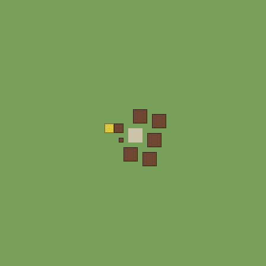
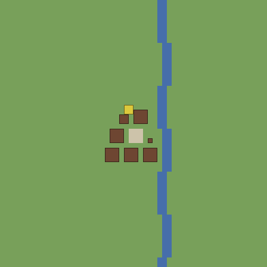
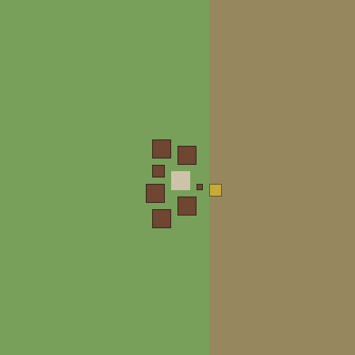
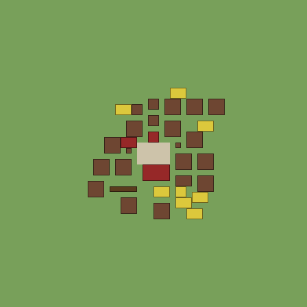
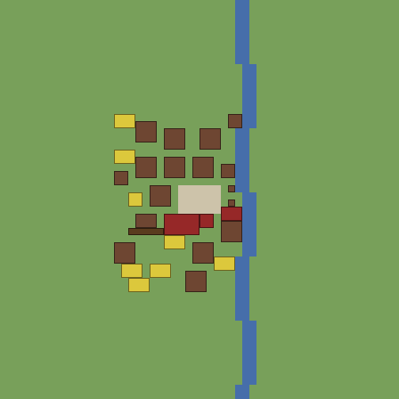
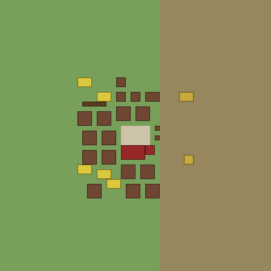
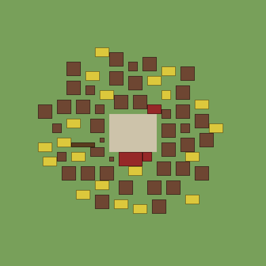
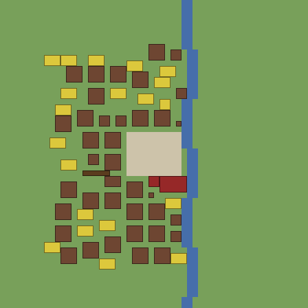
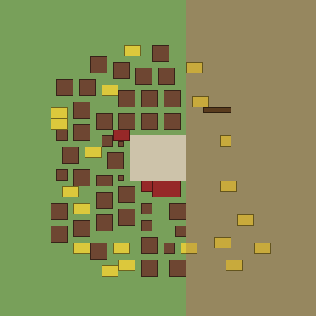

# Village forms mockup

The three tiers of ADR 0076 laid by its roles, for #169, before the pull request opens.

## What made them

- `mockup.cpp` here links `core/layout.cpp` and the base pack from `feat/village-forms` at 22f03a29 plus the working tree's uncommitted layout code, the same `place` growth and generation call.
- Each village lays the base pack's village start list, the hamlet's for the hamlet, then the growth's builds in turn: 2 more for the hamlet, 22 for the village and 62 for the town.
- Each tier uses its pack values: a 3 x 3 square within 8 cells, 6 x 4 within 12, and 10 x 8 within 20.
- A plan that finds no corner within the vicinity is skipped; the program prints how many were laid.
- Ground on a 56-cell lot:
  - flat: all plain;
  - river: two-cell water five cells east of the square, with a jog every 9 rows;
  - hills: rough cells from five cells east of the square.

## Colours

- Pale stone: the square.
- Red: square-role buildings, the hall, well, smithy and apothecary.
- Brown: homes, houses, granaries, barrels and storehouses.
- Dark brown: the fence.
- Yellow: fields; ochre on hills marks a terraced field.
- Green: plain. Tan: hills. Blue: water.

## Laid

| Tier | Flat | River | Hills |
|---|---|---|---|
| Hamlet | 8 of 8 | 8 of 8 | 8 of 8 |
| Village | 33 of 36 | 29 of 36 | 29 of 36 |
| Town | 65 of 76 | 61 of 76 | 65 of 76 |

## Images

| Tier | Flat | River | Hills |
|---|---|---|---|
| Hamlet |  |  |  |
| Village |  |  |  |
| Town |  |  |  |

## What it shows

- **Hills.** Houses stay on flat cells, and fields terrace the hill side once flat cells nearer by path are taken.
- **River.** The village stops at the bank and does not cross it. The river here is five cells off the square, so the village does not string along it. A square laid beside water would string along the bank.
- **Flat ground.** Homes keep a cell apart, so lanes run between them, and the layout comes out regular, close to a grid. ADR 0076's first sign that the decision was wrong names this.
- **Fields.** An edge is placed beyond the farthest home at the moment it is laid, so homes laid later pass it. Fields then sit among later houses, not only at the rim.
- **Vicinity.** The village and town tiers leave 3 to 15 builds unplaced, mostly fields, which find no corner two steps beyond the farthest home.
